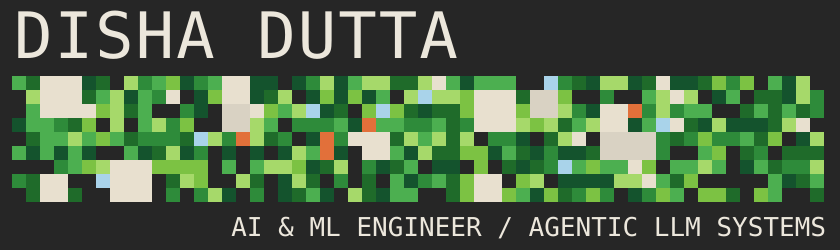
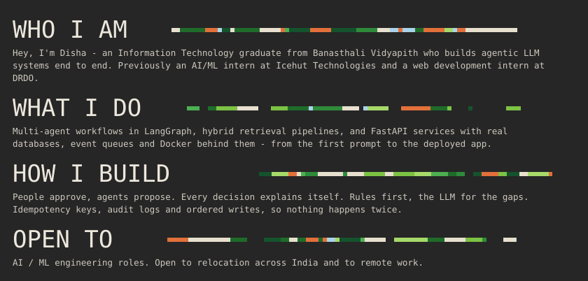
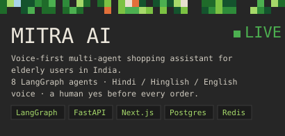
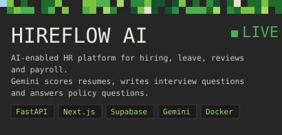
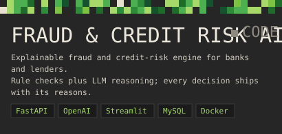
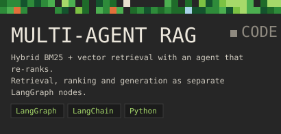
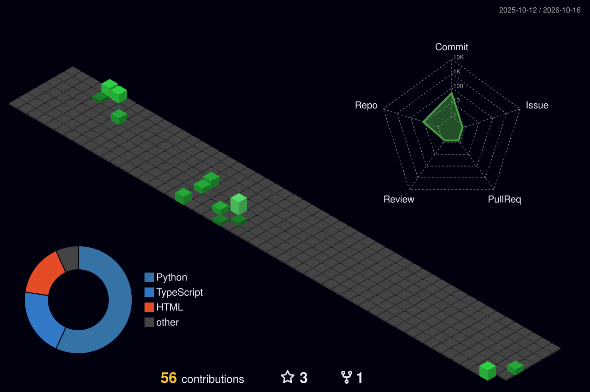
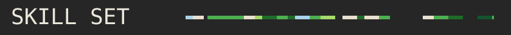
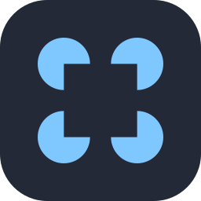

  

  

<table align="center">
  <tr>
    <td rowspan="2" align="center"></td>
    <th align="center">LinkedIn</th>
    <th align="center">Gmail</th>
    <th align="center">Portfolio</th>
    <th align="center">Résumé</th>
    <th align="center">GitHub</th>
    <td rowspan="2" align="center"></td>
  </tr>
  <tr>
    <td align="center"></td>
    <td align="center"></td>
    <td align="center"></td>
    <td align="center"></td>
    <td align="center"></td>
  </tr>
</table>

<table align="center">
  <tr>
    <td width="50%" valign="top">
      
      
🟢 <a href="https://mitra-ai-seven.vercel.app"><b>Live app</b></a> · <a href="https://github.com/dishadutta04/MitraAI">Code</a> · <a href="https://disha-portfolio-eight-sandy.vercel.app/projects/mitra-ai">Case study</a>

    </td>
    <td width="50%" valign="top">
      
      
🟢 <a href="https://hirepro-three.vercel.app"><b>Live app</b></a> · <a href="https://github.com/dishadutta04/HirePro">Code</a> · <a href="https://disha-portfolio-eight-sandy.vercel.app/projects/hireflow">Case study</a>

    </td>
  </tr>
  <tr>
    <td width="50%" valign="top">
      
      
<a href="https://github.com/dishadutta04/fraud-detection-credit-risk-ai">Code</a> · <a href="https://disha-portfolio-eight-sandy.vercel.app/projects/fraud-credit-ai">Case study</a>

    </td>
    <td width="50%" valign="top">
      
      
<a href="https://github.com/dishadutta04/Multi-Agent-RAG-System-using-LangGraph">Code</a> · <a href="https://disha-portfolio-eight-sandy.vercel.app/projects/multi-agent-rag">Case study</a>

    </td>
  </tr>
</table>

  

<table align="center">
  <tr>
    <td align="center" width="96"> Python</td>
    <td align="center" width="96"> TypeScript</td>
    <td align="center" width="96"> JS</td>
    <td align="center" width="96"> C++</td>
    <td align="center" width="96"> HTML</td>
    <td align="center" width="96"> CSS</td>
    <td align="center" width="96"> LangGraph</td>
    <td align="center" width="96"> LangChain</td>
  </tr>
  <tr>
    <td align="center" width="96"> Gemini</td>
    <td align="center" width="96"> Sklearn</td>
    <td align="center" width="96"> TensorFlow</td>
    <td align="center" width="96"> OpenCV</td>
    <td align="center" width="96"> FastAPI</td>
    <td align="center" width="96"> Next.js</td>
    <td align="center" width="96"> Tailwind</td>
    <td align="center" width="96"> Streamlit</td>
  </tr>
  <tr>
    <td align="center" width="96"> Postgres</td>
    <td align="center" width="96"> MySQL</td>
    <td align="center" width="96"> Redis</td>
    <td align="center" width="96"> Supabase</td>
    <td align="center" width="96"> Docker</td>
    <td align="center" width="96"> Git</td>
    <td align="center" width="96"> GitHub</td>
    <td align="center" width="96"> Vercel</td>
  </tr>
</table>
